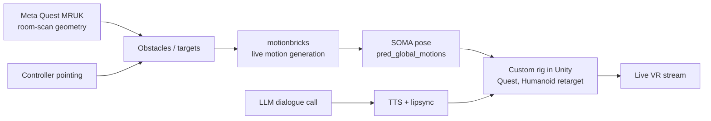
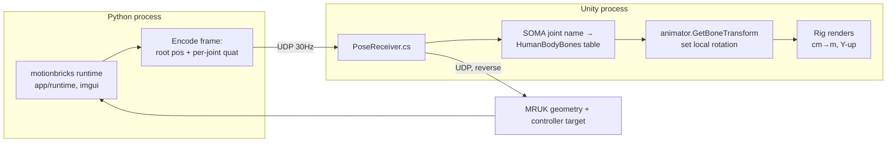

# Overview — motionbricks bridge

## 1. Larger scope (full pipeline)

## 2. Backend (live retargeting data flow)

Notes:
- Two separate OS processes, one socket pair, no Blender in the live loop.
- Blender/Rokoko retargeting is offline-only (clip validation before Unity wiring).
